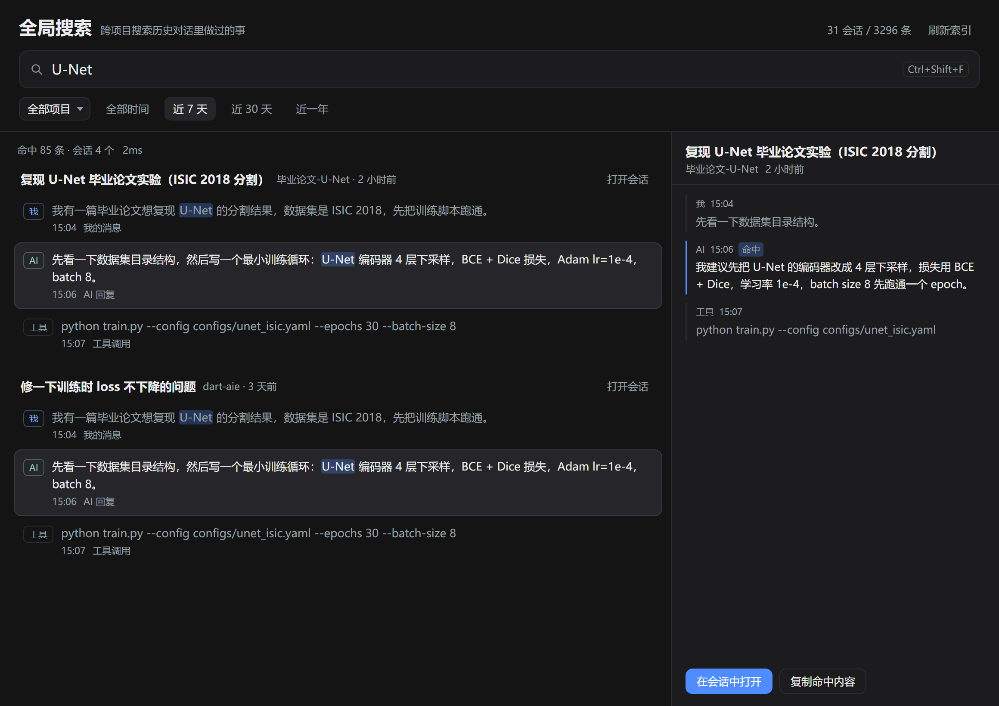

# DSH Recall · 全局历史对话搜索

> 给 [DeepSeek Harness](https://github.com/deepseek-ai/deepseek-harness) 加一个「翻旧账」的入口：
> 不管你把它当下用了多少个项目、多少个会话、聊过多少任务，输入一个词，就能找回当时说过的话、得到的结论、跑过的命令。

插件包名 `dsh-recall`，仓库沿用创建时的名字 `DSH-old-opinion-search-OPS-`。



*上图是面板的静态渲染预览（用插件自身的 CSS 和一份示例数据生成，见 `dsh-recall/scripts/mock.mjs`）。*

---

## 目录

- [它解决什么问题](#它解决什么问题)
- [功能](#功能)
- [快速开始](#快速开始)
- [使用](#使用)
- [工作原理](#工作原理)
- [性能](#性能)
- [目录结构](#目录结构)
- [限制](#限制)
- [Roadmap](#roadmap)
- [兼容性](#兼容性)
- [卸载](#卸载)
- [许可证](#许可证)

---

## 它解决什么问题

用 AI 干活的方式变了，但「找回来」的方式没变：

- 一个项目开很多会话，一个会话里跑很多任务；
- 一周后再想找「上次那个报错是怎么修的」「那版 prompt 怎么写的」「结论放在哪」；
- 侧栏列表只有标题，而且会话越堆越多，翻不动。

DSH 自带一个会话搜索（`Mod+K`），但在这个版本里它救不了场，原因有两层：

1. **内容索引默认关闭。** `@deepseek-ai/dsh-session-query-sqlite` 在 base 组合层以 `openAt: never` 挂载，所以侧栏搜索只匹配**标题和工作区名**，搜消息内容永远搜不到。
2. **就算打开也不适合中文。** 它的全文索引用 SQLite FTS5 的 `unicode61` 分词器，按空白分词——一串中文是一个整词，搜「论文」不会命中「毕业论文」；而且每个会话只回一条最佳片段，最多 20 个会话，点开只到会话、不到消息。

DSH Recall 换了一条路：**不做分词，直接在事件文本上做不区分大小写的子串匹配**。中文、英文、代码片段一视同仁，命中多少显示多少，并且直接在右侧给出命中消息的上下文。

## 功能

- **全局**：跨所有项目、所有会话，不受当前打开的是哪个会话影响
- **中文友好**：子串匹配，任意片段可搜（`论文`、`分割结果`、`发票`、`那个报错`）
- **按会话分组**：同一会话里的多处命中全部列出，不会只给你一条
- **上下文预览**：选中命中即可看该消息及前后各几条，再决定要不要打开会话
- **过滤**：按项目（会话工作目录）、按时间（7 / 30 / 365 天）
- **键盘操作**：`↑` `↓` 移动、`Enter` 打开、`Esc` 清空，`Ctrl+Shift+F` 随时唤起
- **状态记忆**：关掉面板再回来，查询词和过滤条件还在
- **本地**：索引只在 Host 进程内存里，HTTP 接口与 GUI 同源，不出本机
- **容错**：单个会话日志损坏只跳过它，不影响其余会话；索引逐个会话可见

## 快速开始

### 环境

- DSH Desktop，profile 为 `desktop`（默认）
- 插件通过 `~/.dsh/profiles/desktop` 挂载；Host 的 HMR 会在运行中直接加载，**不需要重启应用**
- 不需要 `pnpm install`，没有额外 npm 依赖

### 安装

```powershell
git clone https://github.com/W-HTian/DSH-old-opinion-search-OPS-.git
cd DSH-old-opinion-search-OPS-
powershell -ExecutionPolicy Bypass -File .\dsh-recall\scripts\install.ps1
```

脚本做两件幂等的事：

1. 在 `~/.dsh/profiles/desktop/node_modules/dsh-recall` 建一个指向本仓库 `dsh-recall/` 的 junction；
2. 在 `~/.dsh/profiles/desktop/cordis.patch.yml` 追加一条 `dsh-recall` 的 Loader insert（已存在则跳过）。

装完侧栏就多一行 **全局搜索**，按 `Ctrl+Shift+F` 也能直接打开。

### 手动安装（不想用脚本）

```yaml
# ~/.dsh/profiles/desktop/cordis.patch.yml 末尾追加
- insert:
    - id: dsh-recall
      name: dsh-recall
```

```powershell
cmd /c mklink /J "$env:USERPROFILE\.dsh\profiles\desktop\node_modules\dsh-recall" "D:\path\to\repo\dsh-recall"
```

DSH 监听 profile 配置和链接包的文件变化，保存后自动重载。

## 使用

| 操作 | 效果 |
| --- | --- |
| 侧栏「全局搜索」/ `Ctrl+Shift+F` | 打开面板，焦点落到输入框 |
| 输入关键词 | 240ms 防抖后搜索；空格分隔表示「都要包含」 |
| `↑` `↓` | 在命中之间移动，右侧同步预览上下文 |
| `Enter` | 在会话中打开选中的命中 |
| 双击结果 / 「打开会话」 | 在会话中打开 |
| 「全部项目」下拉 | 限定到某个会话工作目录 |
| 全部时间 / 近 7 天 / 30 天 / 一年 | 按命中时间过滤 |
| 「刷新索引」 | 立即重扫会话日志（索引 5 分钟后本来也会自动过期） |
| 「复制命中内容」 | 把右侧高亮那条消息复制到剪贴板 |

空面板会列出最近活跃的项目，点一下就能限定范围。

## 工作原理

```
DSH Host                                        浏览器
┌────────────────────────────────┐             ┌──────────────────────┐
│ dsh-recall (host)              │   JSON      │ dsh-recall (client)  │
│   ctx.sessionQuery             │◀───────────▶│  侧栏行 + main 面板  │
│     listSessions()             │  /dsh-recall│  输入 / 过滤 / 列表  │
│     filterEvents(surface=cur)  │  /api/…     │  片段高亮 / 上下文   │
│   ↓ 内存索引（原文 + 小写副本） │             │                      │
└────────────────────────────────┘             └──────────────────────┘
```

**索引内容**：只取每个会话 **current surface** 的 `user/message`、`assistant/message`、`tool/call`、`tool/result`、`todo/write`；单条文本截断到 4000 字符。子代理会话（`header.parentSession` 存在）不索引，避免同一段话出现多份。会话标题用该会话第一条用户消息（这个版本的标题事件没有落盘）。

**搜索**：对每条文本（及其小写副本）做子串匹配；多词查询要求全部命中；按命中次数排序，同分按时间倒序。返回上限 300 条，默认 150 条。

**索引生命周期**：

- 第一次打开面板或第一次搜索时构建（不拖慢 DSH 启动）；
- 每个会话索引完成即可被搜到，面板顶部显示索引状态；
- 索引 5 分钟后过期，下一次搜索在**后台**重建，当前查询立即返回旧索引；
- 索引跨 Host 插件热重载保留（放在 `globalThis` 上），改代码不会重复扫盘；
- 进程重启后重建。

**为什么不用现成的 FTS5**：见[上一节](#它解决什么问题)。顺带一提，DSH 的 `sessionQuery.filterEvents({text})` 也能做子串扫描，但它每次调用都要重放并校验整份日志——所以这里只在建索引时调它一次，之后在内存里匹配。

**HTTP 接口**（与 GUI 同源，仅本机）：

| 方法 | 路径 | 说明 |
| --- | --- | --- |
| GET | `/dsh-recall/api/status` | 索引状态 + 项目列表 |
| GET | `/dsh-recall/api/search?q=&project=&days=&limit=` | 搜索 |
| GET | `/dsh-recall/api/context?sessionId=&seq=&before=&after=` | 命中消息及上下文 |
| POST | `/dsh-recall/api/refresh` | 强制重建索引 |
| POST | `/dsh-recall/api/log` | 浏览器端诊断日志转发到 Host |

## 性能

本机实测（32 个会话、3624 条索引事件、约 3.6k 条消息）：

| 指标 | 数值 |
| --- | --- |
| 首次建索引 | 2–12 s（本机实测，取决于日志大小与磁盘缓存；逐会话可见） |
| 单次搜索（85 条命中） | **2 ms** |
| 搜索 3.6k 条文本 | 1–5 ms |
| 索引内存 | 约 10–20 MB |

## 目录结构

```
.
├── README.md                  # 本文件
├── LICENSE
├── docs/
│   └── preview.png            # 面板预览
└── dsh-recall/                # 插件本体
    ├── package.json           # dsh.client / dsh.bundle 声明
    ├── cordis.patch.yml       # bundle 层的 Host 条目
    ├── README.md              # 插件详细说明
    ├── lib/
    │   ├── index.js           # Host：索引 + JSON API
    │   └── client.js          # 浏览器：侧栏行 + 面板（Module Loader factory）
    └── scripts/
        ├── install.ps1        # junction + profile patch（幂等）
        └── mock.mjs           # 用真实 CSS 渲染静态预览
```

## 限制

- **子串，不是语义**：搜「部署」不会自动找到「上线」。这是刻意取舍——保证中文可搜、结果可预测。
- **只看当前消息面**：被后续消息替换/隐藏的历史（`shadowed`、`log-only`）不参与搜索。
- **长文本截断**：单条 4000 字符，很长的命令输出只有开头可搜。
- **索引在内存**：会话非常多（数百个、GB 级日志）时首次构建会变慢；重启后要重建。
- **依赖 DSH 内部接口**：用了 `ctx.sessionQuery`、`ctx.webServer`、客户端 slot / Module Loader。DSH 大版本升级后可能需要跟着改。
- **非官方插件**：实验性质，未发布到 npm；profile 被重置或升级重写后需重跑 `install.ps1`。

## Roadmap

- [ ] 索引落盘（按会话 mtime 增量），重启免重建
- [ ] 从投影缓存读真实会话标题，而不是首条用户消息
- [ ] 搜索结果的**消息级深链**（打开会话并滚动到命中位置）
- [ ] 语义 / 向量召回，作为子串搜索的第二路结果
- [ ] 中英文 UI 跟随 DSH 语言设置（目前固定中文）

## 兼容性

| 项 | 值 |
| --- | --- |
| 开发环境 | DSH Desktop 2.0.21-next，内置 `@deepseek-ai/dsh` 0.2.1-rc.4 |
| 运行位置 | Host（Node） + Web 客户端（浏览器）双半边 |
| 依赖服务 | `sessionQuery`（由 `dsh-session-query-sqlite` 提供，`openAt: never` 也可用）、`webServer` |
| 平台 | Windows 桌面版验证通过；脚本为 PowerShell，Linux/macOS 手动建软链即可 |

## 卸载

```powershell
# 1. 删掉 junction
cmd /c rmdir "$env:USERPROFILE\.dsh\profiles\desktop\node_modules\dsh-recall"

# 2. 删掉 cordis.patch.yml 末尾的 dsh-recall insert 块
```

保存后 DSH 自动卸载插件，侧栏那一行随之消失。

## 许可证

[MIT](LICENSE)

---

### English summary

**DSH Recall** is a community plugin for DeepSeek Harness that adds a global, CJK-friendly full-text search over every past conversation (messages, tool calls, tool results, todos) across all workspaces. DSH's built-in search matches titles only by default, and its SQLite FTS5 backend uses the `unicode61` tokenizer, which cannot match substrings inside a run of Chinese characters. DSH Recall indexes semantic event text in memory and does literal case-insensitive substring matching, groups hits by session, and previews the surrounding context before you jump into the conversation. Host half: `ctx.sessionQuery` exact reads plus a small JSON API; client half: a sidebar panel and root panel registered through the client slot system. Install with `dsh-recall/scripts/install.ps1` (junction + profile patch, hot-loaded by the Host, no restart).
